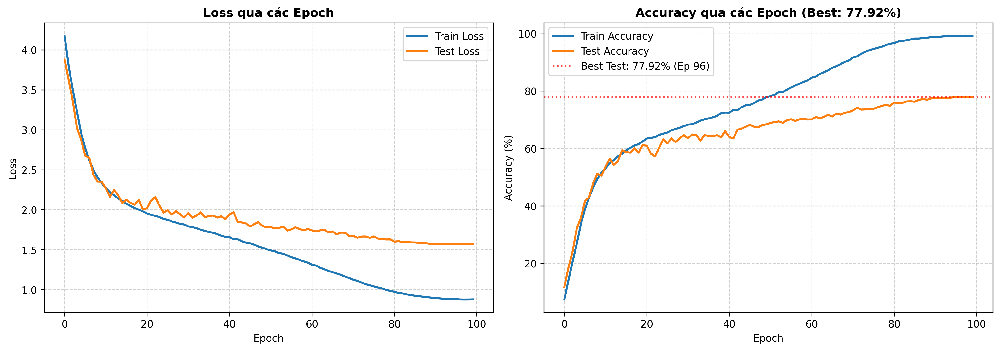
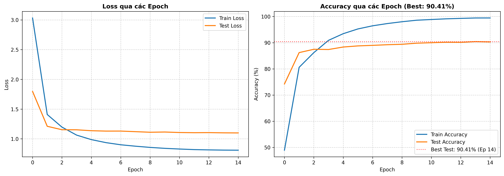

# CIFAR-100 Classification

My experiments on CIFAR-100 (100 classes, 50k train / 10k test, 32x32 RGB). I started with a ResNet-18 trained from scratch, then moved to fine-tuning ConvNeXt-Tiny and ViT-B/16, and finally averaged the two pretrained models.

Everything was trained on Google Colab (NVIDIA L4, 24 GB) with PyTorch, bfloat16 autocast and TF32 on.

## Results

| Run | Model | Params | Train / Val / Test | Epochs | Best Val | Test Top-1 | Test Top-1 (flip TTA) | Test Top-5 (flip TTA) |
| :--- | :--- | :---: | :---: | :---: | :---: | :---: | :---: | :---: |
| v1 | Simple CNN | — | 50k / — / 10k | 30 | — | 31.28% | — | — |
| v2 | Deeper CNN | — | 50k / — / 10k | 50 | — | 41.30% | — | — |
| resnet18 | ResNet-18 (CIFAR stem), Adam | 11.2M | 50k / — / 10k | 50 | — | 34.19% | — | — |
| v3 | resnet18 + label smoothing | 11.2M | 50k / — / 10k | 50 | — | 30.86% | — | — |
| v4 | ResNet-18, SGD + cosine + RandomErasing | 11.2M | 50k / — / 10k | 100 | — | 77.92% | — | — |
| v5 | ConvNeXt-Tiny (ImageNet-1K) | 27.9M | 50k / — / 10k | 15 | — | 90.41% | 90.64% | 98.63% |
| v6 | ConvNeXt-Tiny, proper val split | 27.9M | 45k / 5k / 10k | 15 | 90.02% | 89.92% | 89.96% | 98.54% |
| v7 | ConvNeXt-Tiny + MixUp/CutMix | 27.9M | 45k / 5k / 10k | 20 | 90.26% | 90.63% | 90.64% | 98.76% |
| v8 | ViT-B/16 (ImageNet-21K) | 85.9M | 45k / 5k / 10k | 15 | 93.22% | 93.24% | 93.28% | 99.41% |
| ens | 0.6 × v8 + 0.4 × v7 | 113.8M | 45k / 5k / 10k | — | — | — | **93.54%** | **99.49%** |

Notes:
- v1–v5 had no validation set. The number reported is the best test accuracy over all epochs, so it is a bit optimistic. From v6 on, the checkpoint is picked on validation and the test set is evaluated once.
- Flip TTA = average of the softmax on the original image and its horizontal flip.
- The v1/v2 notebooks were overwritten during iteration; only their training curves are left in `training_evaluation/`.

## Files

```text
pipeline.ipynb                              ResNet-18 from scratch (final version = v4)
pipeline_transfer.ipynb                     ConvNeXt-Tiny, v5
pipeline_transfer_convNext_Tiny_v6.ipynb    ConvNeXt-Tiny with 45k/5k/10k split, v6
pipeline_transfer_convNext_Tiny_v7.ipynb    ConvNeXt-Tiny + MixUp/CutMix, v7
pipeline_transfer_ViT_B16_v8.ipynb          ViT-B/16 + ensemble, v8
training_evaluation/                        loss/accuracy curves
```

The notebooks expect Colab with Google Drive mounted (checkpoints and plots are saved to `/content/drive/MyDrive/Cifar-100/`). Dependencies: `torch`, `torchvision`, `timm`, `numpy`, `matplotlib`.

## 1. ResNet-18 from scratch (`pipeline.ipynb`)

The model is a standard ResNet-18 adapted to 32x32 inputs: a 3x3 stride-1 stem with no max-pool, four stages of two basic blocks (64/128/256/512 channels), GELU activations, and dropout 0.3 before the final linear layer. 11,220,132 parameters.

- **resnet18 (34.19%)**: Adam (lr 2e-3, weight_decay 5e-3), batch 256, no LR schedule, random crop + flip. It underfit badly (train accuracy only ~35% after 50 epochs) because weight decay this large inside Adam acts as a strong L2 penalty. Test accuracy also swung a lot (34% down to 23%) since the LR never decayed.
- **v3 (30.86%)**: same setup plus label smoothing 0.1. Accuracy went down, which makes sense: more regularization on a model that is already underfitting.
- **v4 (77.92%)**: same model, different recipe:
  - SGD (lr 0.1, momentum 0.9, Nesterov, weight_decay 5e-4) with cosine annealing over 100 epochs
  - batch size 128 instead of 256
  - RandomErasing (p=0.5) after normalization, label smoothing kept
  - moved `backward()` and `optimizer.step()` out of the autocast block

The training recipe mattered far more than the architecture here: +43.7 points without touching the model.



## 2. Fine-tuning ConvNeXt-Tiny

**v5 (`pipeline_transfer.ipynb`)**

- `torchvision` ConvNeXt-Tiny with ImageNet-1K weights, last linear layer replaced with a 100-class one.
- Images upscaled from 32x32 to 224x224 (bicubic), ImageNet mean/std. Train augmentations: RandomResizedCrop (scale 0.8–1.0), horizontal flip, RandomErasing (p=0.25).
- AdamW (weight_decay 1e-2), lr 1e-4 for the backbone and 1e-3 for the head. 2-epoch linear warmup, then cosine decay. Label smoothing 0.1, gradient clipping at 1.0. 15 epochs, batch 128.
- Flip TTA gave +0.23% (90.41% → 90.64%). Adding a 0.9x center zoom as extra views made it slightly worse (90.57%), probably because cropping an upscaled 32x32 image throws away real content.



**v6 (`pipeline_transfer_convNext_Tiny_v6.ipynb`)**

Up to v5 I was choosing the best epoch on the test set. v6 fixes that:
- Fixed seed 42 everywhere (Python, NumPy, PyTorch, CUDA, DataLoader workers).
- Stratified 45k/5k train/val split (50 val images per class). The val subset is built from a separate dataset object without augmentation.
- Early stopping on val accuracy (patience 5); test set evaluated once at the end.

Val (90.02%) and test (89.92%) ended up within 0.1%, so the val set is a good proxy. The model still overfits: 99.44% train accuracy, train loss 0.81 vs val loss 1.12.

**v7 (`pipeline_transfer_convNext_Tiny_v7.ipynb`)**

Same seed and split as v6. Changes:
- MixUp (alpha 0.2) or CutMix (alpha 1.0), picked at random and applied to half of the batches on the GPU.
- Removed RandomErasing (CutMix already does something similar) and used the default bilinear resize.
- 20 epochs, patience 6.

The overfitting is gone (train loss 1.12 vs val loss 1.10, train accuracy 95%). Test errors went from 1,008 to 937, mostly on the hard classes: willow_tree 63% → 70%, seal 75% → 81%, boy 62% → 66%.

## 3. ViT-B/16 and the ensemble (`pipeline_transfer_ViT_B16_v8.ipynb`)

**v8**

- `timm` model `vit_base_patch16_224.augreg_in21k_ft_in1k` (pretrained on ImageNet-21K), stochastic depth 0.1.
- Normalization (0.5, 0.5, 0.5) to match these weights.
- Smaller LRs than ConvNeXt: 5e-5 backbone, 5e-4 head, AdamW weight_decay 0.05.
- Everything else as in v7: MixUp/CutMix, label smoothing, warmup + cosine, 15 epochs, same seed and split.

Val 93.22% vs test 93.24%. Val loss (0.99) stays below train loss (1.12) because of MixUp/CutMix, so no sign of overfitting. Test errors dropped from 937 to 676; the people classes improved the most (boy 66% → 80%, man 74% → 85%).

**Ensemble**

Weighted average of flip-TTA probabilities: 0.6 × ViT + 0.4 × ConvNeXt (v7). Both models run in the same loop; the batch is normalized for ViT and converted to ImageNet normalization on the GPU before going into ConvNeXt.

ConvNeXt alone is 2.64 points behind ViT, but the ensemble still adds +0.26% top-1 (93.28% → 93.54%). Only 51 of 10,000 test images miss the top 5.

## Where the errors are

Breakdown of the 676 test errors of v8. Most errors are confusions between classes in the same superclass, which are hard to tell apart at 32x32:
- Trees: oak ↔ maple (35), pine → oak (13), willow → maple/oak (18)
- People: baby → boy (12), girl → woman/baby (16), man ↔ boy (16)
- Others: plate → bowl, seal → otter, train → streetcar

## Speed notes (L4)

- DataLoader: 4 workers for 32x32, 6 for 224x224, `pin_memory`, `persistent_workers`, `prefetch_factor=4`, `non_blocking` copies. This cut data loading from 9.03 s to 4.58 s per epoch on the 32x32 runs.
- bfloat16 autocast, so no GradScaler needed.
- 45k images at 224x224, batch 128: about 140 s/epoch for ConvNeXt-Tiny and 212 s/epoch for ViT-B/16.
